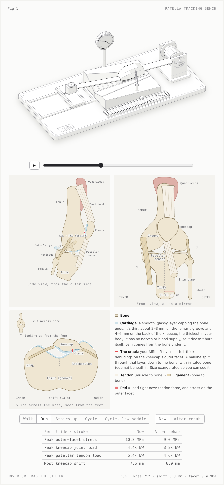
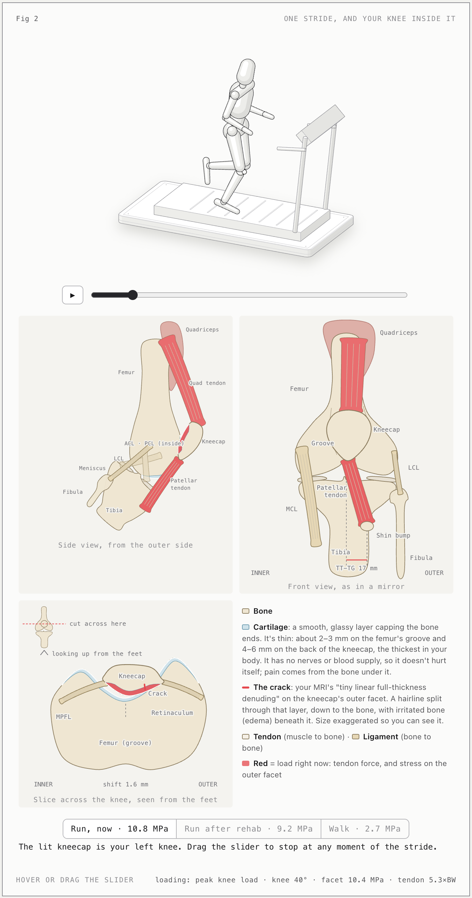
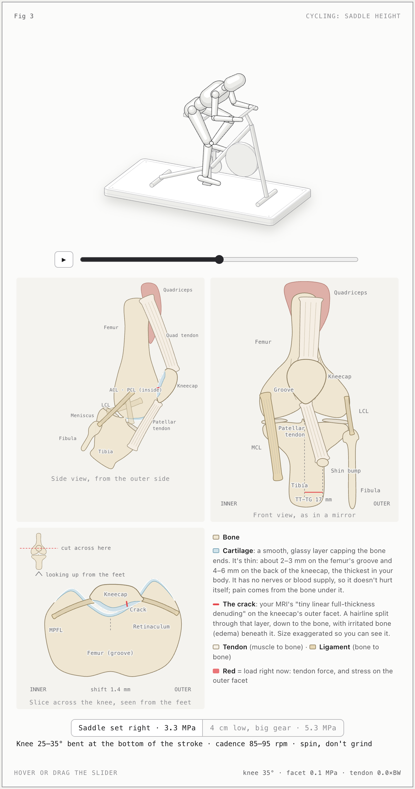
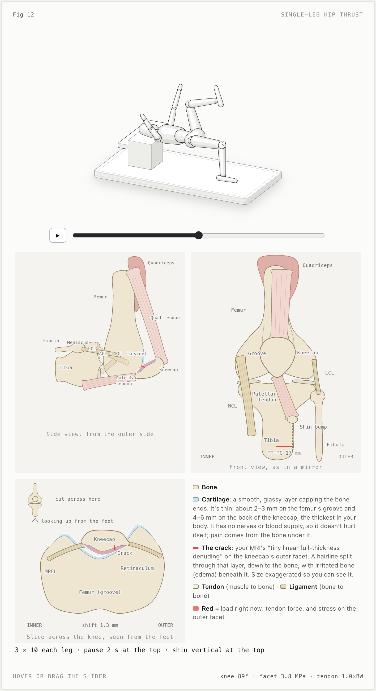

# Knee model from an MRI

An interactive, self-contained model of a left knee, driven by an MRI report. It shows what the kneecap, cartilage and tendons do during walking, running, cycling, home exercises and gym lifts, and lays out a 6-week marathon plan.

**Live page:** https://saadsaifse.github.io/knee-model-mri/ (dark theme: [knee-v3.html](https://saadsaifse.github.io/knee-model-mri/knee-v3.html))

> Educational model, not medical advice. The drawings are schematic, not traced from the scan, and the numbers come from published averages (Huberti & Hayes contact areas, a pulley model of the kneecap, a lateral shift calibrated to the MRI). Talk to your physio or doctor before acting on it.

## MRI findings modelled

- Mild lateral patellar subluxation (0.8 cm), TT-TG 1.7 cm
- Trace chondromalacia with a tiny full-thickness cartilage defect and subchondral edema on the lateral patellar facet
- Mild quadriceps and patellar tendinosis
- Medial meniscus extrusion without a tear, and a subcentimetre Baker's cyst

## Screenshots

**Fig 1: patella tracking bench.** The kneecap rides in its groove as the knee bends. A gauge reads the outward shift and the stress on the outer facet.



**Fig 2: one running stride.** A treadmill runner, with the knee shown from the side, from the front and in a cross-section slice. Every view moves with the stride.



**Fig 3: cycling saddle height**, and **Fig 12: single-leg hip thrust** (one of 13 figures)

<p> </p>

Every figure has hover, a slider and play/pause.

## Files

| Page | What it covers |
|---|---|
| `index.html` / `knee-v3.html` (+ `-light`) | Latest: anatomy views, running stride, cycling, gym comparison, cartilage crack, marathon plan |
| `knee-v2.html` (+ `-light`) | Cycling, gym machines, cartilage and the marathon, without the anatomy panels |
| `knee.html` (+ `-light`) | First version: walking and running, plus home exercises |

The html files are standalone. Open any of them directly in a browser.

## Rebuilding

You need Node 18+ and no packages.

```sh
node build-v3.mjs          # knee-v3.html
node build-v3.mjs --light  # knee-v3-light.html
```

- `model.mjs` holds the biomechanics: quad force, the force between the kneecap and the femur, contact area, lateral shift and facet stress. Every number shown on the pages comes from it.
- `bench.mjs`, `mannequin.mjs`, `gym.mjs`, `exercises.mjs` and `anatomy-knee.mjs` hold the geometry and figures.
- `v2/` and `v3/` hold the prose.
- `vendor/anatomy/` is the isometric drawing kit (MIT, see its LICENSE).
